<picture>
  <source media="(prefers-color-scheme: dark)" srcset="./assets/header-dark.svg">
  
</picture>

I build backend systems in **Java** and spend a lot of time on **AWS**, writing Lambdas in TypeScript and Python 
and running workloads on **Kubernetes**. Outside work I build tools that help me think and work better.

<picture>
  <source media="(prefers-color-scheme: dark)" srcset="./assets/divider-dark.svg">
  
</picture>

### How I work

<picture>
  <source media="(prefers-color-scheme: dark)" srcset="./assets/loop-dark.svg">
  
</picture>

**Spec-Driven Development** and **loop engineering**: AI-in-the-loop workflows where the spec is the source of truth 
and verification decides when each step is done. I follow AI closely and keep what lasts.

### Projects

My main project is **ZettelFlow**, an Obsidian plugin that turns a canvas into a note-creation workflow and the vault into something you can think with. 
Before it, **DB Folder**, a database view for Obsidian notes (1.4k ★, now archived).

<a href="https://github.com/RafaelGB/Obsidian-ZettelFlow"><picture><source media="(prefers-color-scheme: dark)" srcset="./assets/card-zettelflow-dark.svg"></picture></a>
<a href="https://github.com/RafaelGB/obsidian-db-folder"><picture><source media="(prefers-color-scheme: dark)" srcset="./assets/card-dbfolder-dark.svg"></picture></a>

ZettelFlow docs: <a href="https://rafaelgb.github.io/Obsidian-ZettelFlow/">rafaelgb.github.io/Obsidian-ZettelFlow</a>

### Stack

<picture>
  <source media="(prefers-color-scheme: dark)" srcset="https://skillicons.dev/icons?i=java,ts,py,aws,kubernetes,docker,react,nodejs&theme=dark">
  
</picture>

<picture>
  <source media="(prefers-color-scheme: dark)" srcset="./assets/divider-dark.svg">
  
</picture>

<a href="https://www.linkedin.com/in/rafael-gomez-bermejo/">LinkedIn</a> · <a href="https://github.com/RafaelGB">GitHub</a>

